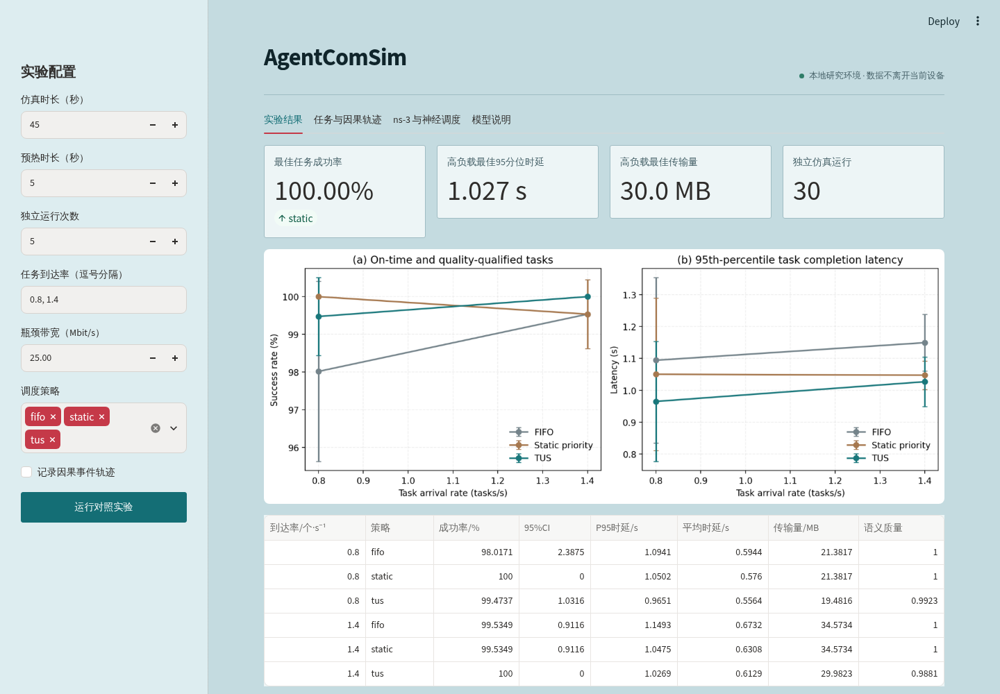

# AgentComSim

AgentComSim is a task-centric research simulator for agent communication networks. It couples message transmission, computation queues, task deadlines, and semantic quality in one reproducible discrete-event model.

[中文说明](README.zh-CN.md) · [Architecture](docs/architecture.md) · [Reproducibility](docs/reproducibility.md)



## Capabilities

- Message-level SimPy engine with a parallel sensing/tool task graph.
- FIFO, static-priority, and task-utility-aware scheduling (TUS).
- Common random numbers, independent seeds, and 95% confidence intervals.
- Optional PyTorch neural scheduler with seed-isolated train/validation/test splits.
- One-way ns-3 packet-level scenario export, C++ UDP bridge, and result calibration.
- CLI, local Streamlit workbench, CSV/JSON/YAML artifacts, and causal event traces.

The default simulator is a message-level abstraction, not a wireless-channel or protocol-stack model. The ns-3 integration is one-way validation/calibration, not closed-loop co-simulation.

## Install

Python 3.11 or newer is required.

```bash
python -m pip install -e .
# Include neural training and the local Web UI:
python -m pip install -e '.[all]'
```

## Quick start

```bash
agentcomsim quickstart --output results/quickstart
agentcomsim run --config configs/quickstart.yaml --output results/quickstart
agentcomsim web
```

Reproduce the full reference experiment (270 simulation runs):

```bash
agentcomsim run --config configs/paper.yaml --output results/paper
```

Each experiment writes `config.resolved.yaml`, `runs.csv`, `summary.csv`, `summary.json`, and `performance.png`.

## Neural scheduler

```bash
agentcomsim neural train -c configs/quickstart.yaml -o results/neural/scheduler.pt --seeds 10 --epochs 40
# Enable the neural policy in a copied configuration, then:
agentcomsim run -c configs/neural.yaml -o results/neural-eval --neural-checkpoint results/neural/scheduler.pt
```

Training imitates TUS priorities observed in real simulator queue states. It does not by itself establish superiority over TUS; evaluate on held-out seeds.

## ns-3 bridge

```bash
agentcomsim ns3 export -c configs/quickstart.yaml -o results/ns3/scenario.csv
agentcomsim ns3 run --scenario results/ns3/scenario.csv --output results/ns3/run --ns3-dir /path/to/ns-3
```

The companion C++ source is included in the package. A real ns-3 installation is required only for packet-level execution.

## Development

```bash
python -m pip install -e '.[all,dev]'
pytest
ruff check .
python -m build
```

See [architecture](docs/architecture.md), [reproducibility](docs/reproducibility.md), [neural training](docs/neural.md), and the [ns-3 guide](docs/ns3.md). Contributions and security reports are covered by `CONTRIBUTING.md` and `SECURITY.md`.

## License

MIT. See `LICENSE`.
