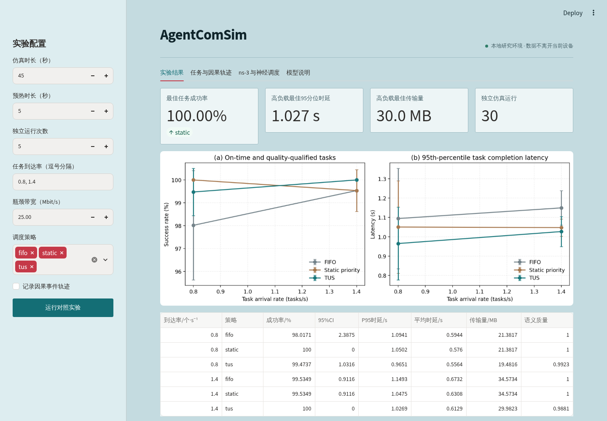

# AgentComSim

AgentComSim 是面向智能体通信网络的任务级研究仿真平台，在同一离散事件模型中联合描述消息传输、计算排队、任务截止期限与语义质量。

[English README](README.md) · [架构](docs/architecture.md) · [复现指南](docs/reproducibility.md)



## 主要能力

- 基于 SimPy 的消息级引擎，支持感知与工具两个并行分支。
- FIFO、静态优先级与任务—语义效用感知调度（TUS）。
- 共同随机数、独立仿真种子和均值的 95% 置信区间。
- 可选 PyTorch 神经调度器，按种子隔离训练、验证和测试轨迹。
- 单向 ns-3 数据包级场景导出、C++ UDP 桥接与时延校准。
- 命令行、本地 Streamlit 工作台，以及 CSV、JSON、YAML 和因果事件导出。

默认内核是消息级抽象，不是无线信道或完整协议栈模型。ns-3 集成用于单向验证和校准，不是闭环联合仿真。

## 安装与运行

需要 Python 3.11 或更高版本。

```bash
python -m pip install -e '.[all]'
agentcomsim quickstart --output results/quickstart
agentcomsim web
```

完整论文配置包含 270 次仿真：

```bash
agentcomsim run --config configs/paper.yaml --output results/paper
```

结果目录包含解析后配置、逐次运行明细、汇总表、JSON 和性能图。

## 文档与边界

详见[架构](docs/architecture.md)、[复现指南](docs/reproducibility.md)、[神经调度器](docs/neural.md)和 [ns-3 指南](docs/ns3.md)。神经调度器采用 TUS 模仿学习，训练损失下降不代表任务指标必然优于 TUS，必须在未参与训练的种子上评估。

## 许可证

MIT，详见 `LICENSE`。
